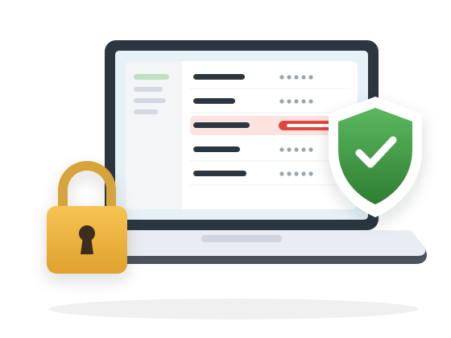

  

<h1 align="center">Sompio</h1>

  
  
  
  

**Find what you've left online. Remove it yourself.**

Sompio finds the passwords, ID and bank numbers, addresses and other personal details you've shared over the years in
your chats, mail and files, and helps you delete them. Vault then keeps your passwords safe from now on. Everything runs
on your own computer: no account, no cloud, nothing uploaded.

## Get started

1. Download Sompio from **[sompio.org](https://sompio.org)** or the
   [latest release](https://github.com/sompiohq/sompio-app/releases/latest). It runs on Windows, Mac and Linux.
2. Open it and follow **Getting started**: learn what counts as personal information, find it, clean it up, and
   secure your accounts.
3. Stuck or curious? The [Learn more](https://sompio.org/docs.php) page explains every part, with step-by-step guides.

## What Sompio does

Made for anyone who just realised how much of their life is still stored online, and wants to deal with it
themselves, without paying a removal service.

**Find and clean it up, with Trace**

- Looks through your folders, mailbox, Telegram and WhatsApp chats, and the data you can download from Discord,
  Reddit, Instagram, X, Facebook, TikTok, Snapchat and LinkedIn
- Spots passwords, backup codes, recovery phrases, card and bank numbers, ID and passport numbers, addresses, birth
  dates, phone numbers and exact locations, plus any words you add yourself
- Puts the riskiest things first and explains each one in plain words
- If you want, also reads text in screenshots and finds photos that reveal where they were taken
- Writes the letters that make companies erase your data, and reminds you when they have to answer
- Shows an exposure score, so you can see it go down

**Stay safe from now on, with Vault**

- Keeps your passwords in one encrypted file, in the open KeePass format you can take anywhere
- Fills in logins for you, in any app or in Chrome, Edge, Brave and Firefox
- Shows 2FA codes, makes strong passwords, and flags weak, reused or leaked ones
- Brings your passwords over from your browser, Bitwarden, 1Password or KeePass

**Your data stays yours**

- No account and no cloud: everything is encrypted on your own computer
- Opened by your password plus a second key that only you have, with a recovery code for emergencies
- No ads, no tracking, and a [public list](https://sompio.org/docs.php#private) of the few times Sompio goes online

## Report a bug

Click **Report a bug** at the top of Sompio, or email [hello@sompio.org](mailto:hello@sompio.org).
Security problems: see [SECURITY.md](SECURITY.md).

## License

Source-available under the [Functional Source License 1.1, Apache 2.0 future license](LICENSE.md) (FSL-1.1-ALv2):
you may read, build and use it, but not offer it as a competing product. Each version becomes Apache 2.0 two years
after its release.
